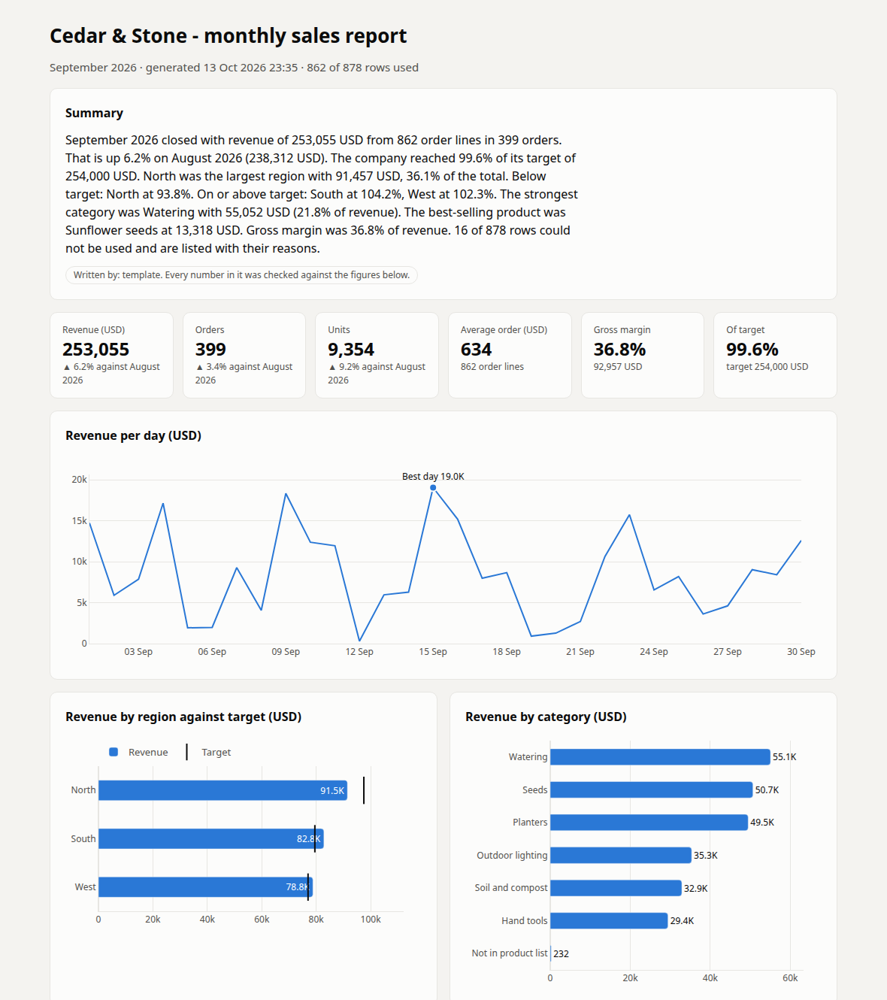
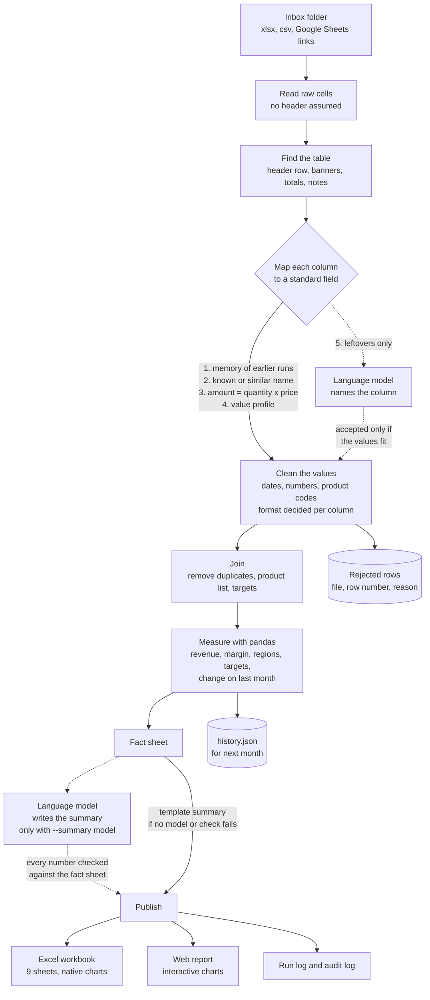

# Spreadsheet and report automation agent

Drop a folder of messy Excel, CSV and Google Sheets exports. Get back one clean monthly
report: an Excel workbook with charts, a web page, a written summary, and a list of every
row that was left out and why.

It is built for the person who spends the first days of each month opening five
spreadsheets from five people, fixing headers, dates and product codes by hand, pasting
everything together and writing the same report again.



## What it does to the files

These are the first lines of the three demo exports, one per branch. None of them can be
loaded by a default table reader.

```text
sales_north_2026-09.xlsx                         a banner above the header, dates as text and as
Cedar & Stone - North branch - sales export      real Excel dates, prices as "$29.75", a TOTAL row
Generated 01/10/2026 by ERP
Confidential

Order No.  | Order Date          | Customer            | Product Code | Qty | Unit Price | Line Total
N2609-0001 | 2026-09-30 00:00:00 | Oakfield Landscapes | SC-0301      | 2   | $29.75     | $59.50
N2609-0001 | 30/09/2026          | Oakfield Landscapes | SC-0304      | 20  | $21.69     | $433.80

south_export_2026-09.csv                         semicolons, Windows encoding, decimal commas,
Date;Invoice #;Branch;Client;Article;Quantity;Price;Amount;Notes        "24 pcs", duplicate lines
16.09.2026;S2609-0001;South;Oakfield Home and Garden;SD-0503;24 pcs;32,25;774,00;

West weekly sales 2026-09.xlsx                   four sheets plus a notes sheet, US dates, headers
Order Ref  | Booked     | Store              | Item No. | Pieces | Each  | Ext. Price   nobody else uses,
W2609-0001 | 09/15/2026 | Hilltop Landscapes | sd-504   | 5      | 5.8   | 29           typos in the codes
```

One command reads them, with the product list and the targets, and prints what it did:

```text
$ python -m sheetagent demo

September 2026
  Collect          5 files or links, 9 sheets read
  Find the table   8 tables found in 9 sheets; 27 banner, blank, header and totals rows left out
  Map the columns  26 by name, 12 by arithmetic, 4 by similar name, 4 by profile; 7 columns not used
  Clean the values 871 sales lines typed, 2254 cell repairs, 7 rows set aside
  Join             862 lines kept for 2026-09; set aside: 6 duplicate line, 3 date not understood, 3 outside the report month 2026-09, 2 no product code, 2 no usable amount
  Measure          revenue 253,055.32 USD, 862 lines, 399 orders, 3 regions, 7 categories; +6.2% on August 2026
  Write            summary from the template
  Publish          sales_report_2026-09.xlsx, sales_report_2026-09.html, summary.md, run.json in reports/2026-09
  ! 1 product code is not in the product list (2 lines, kept in the totals under 'Not in product list').

  September 2026 closed with revenue of 253,055 USD from 862 order lines in 399 orders. That is up 6.2% on
  August 2026 (238,312 USD). The company reached 99.6% of its target of 254,000 USD. North was the largest
  region with 91,457 USD, 36.1% of the total. Below target: North at 93.8%. On or above target: South at
  104.2%, West at 102.3%. [...]

  Excel report: reports/2026-09/sales_report_2026-09.xlsx
  Web report:   reports/2026-09/sales_report_2026-09.html
  Done in 1.3 s (model: mock).
```

The demo data is fictional and generated with its correct answer, so the result can be
checked: all 862 true order lines of September are recovered with every value exact.

## How it works



Solid lines are code. Dotted lines are the two places where a language model can be used,
and both answers are checked by code before they are used. With no model at all
(`LLM_PROVIDER=mock`, the default) the report is still complete: unknown columns stay
unused and the summary comes from a template. The summary stays on the template even with
a model configured, unless `--summary model` is given (the Results section explains why).

**The numbers are never produced by the model.** They are computed by pandas from the
cleaned rows, and the same files always give the same report.

### What "cleaning" covers

| Problem in the file | What the agent does |
|---|---|
| Title, date or logo rows above the header | Finds the first wide row made only of labels with data under it |
| Totals rows, repeated headers, blank rows, note lines | Leaves them out and logs the row numbers |
| Columns named differently in every file | Maps them by name, by close spelling, by arithmetic, by value profile, then by the model |
| `03/04/2026`: 3 April or 4 March? | Decided per column from values above 12, then from the report month, and logged |
| `$1,234.50`, `1.234,50`, `1 234,50 €`, `(45.00)`, `12 pcs` | Parsed; decimal comma or point is decided per column |
| `ht_0101`, ` HT-101 `, `HT-O1O1` | Matched to the product list; look-alike characters repaired only when one product fits |
| Product code missing from the product list | Kept in the totals under "Not in product list" and flagged |
| The same line exported twice | Removed when the file has order numbers; otherwise left and flagged |
| Missing code, unreadable date, no usable amount | Row set aside with file, row number, reason and original content |
| One workbook cut into several sheets | Sheets with the same headers are read as one table |

## Results

All numbers below come from commands run in this repository. The benchmark writes 100
sales files, each spoiled at random (0 to 4 banner rows, one of 8 date formats and 5
number formats, 40% of column names never shown to the rules, typos in product codes,
totals rows, duplicates, unusable rows), cleans each one, and compares the result with the
known truth. The rules were tuned on seeds 11 and 2026; the reported run uses seed 4242,
which was not looked at before.

| Measure | This project, no model | Naive baseline |
|---|---|---|
| Header row found | 100% of 136 sheets | not attempted |
| Order lines recovered with every value exact | 100% | 0.0% |
| Files recovered with no error at all | 81 of 100 | 0 of 100 |
| Mean revenue error per file | 1.2% | 100% |
| Columns with a known name read correctly | 100% of 569 | - |
| Columns with a never-seen name read correctly | 75.1% of 354 | - |
| Irrelevant columns left alone | 100% of 128 | - |
| Unusable rows caught | 100% of 242 | - |
| Good rows wrongly rejected | 0 | - |
| Region correct | 100% | - |
| Time per file | 0.185 s | - |

Command: `python -m evals.run --files 100 --seed 4242` (results in `evals/results.json`).

The naive baseline is `pandas.read_excel` / `read_csv` with default settings and exact
column names (`evals/baseline.py`), which is how most hand-written report scripts start. It
scores zero because every benchmark file combines several defects, and one is enough to
break a default reader.

The 19 files that are not perfect all have the same cause: the order-number column has a
name the rules do not know, so duplicate lines cannot be detected and stay in the total.
Their revenue is overstated by a few percent; no line is lost. This is the gap the
language model is there to close, see below.

### What the language model adds, and where it must not be trusted

No OpenAI key was available during the build, so the model path was run on a small local
model (llama3.2, 3 billion parameters, on CPU through Ollama) with the same client code
that talks to OpenAI. Cost: 0 USD. The OpenAI check itself is still pending.

**Naming leftover columns: useful.** Same 30 files, with and without the model
(`python -m evals.run --files 30 --seed 5151`, then the same with `--provider openai`):

| Measure | Rules only | Rules + local model |
|---|---|---|
| Columns with a never-seen name read correctly | 68.4% of 114 | 93.9% of 114 |
| Files recovered with no error at all | 19 of 30 | 30 of 30 |
| Mean revenue error per file | 1.38% | 0.0% |
| Irrelevant columns left alone | 100% of 45 | 93.3% of 45 |
| Time per file | 0.18 s | 11.8 s |

The model placed 32 columns and was right on 90.6% of them, in 47 calls (7,048 input
tokens, 112 output tokens). The three irrelevant columns it mislabelled were text columns
taken for the customer name, which does not change any total. An earlier run on another
seed showed it labelling a warehouse column as the region in 3 of 30 files, which did move
sales to a wrong region; a guard now refuses a region answer whose values are not known
regions, and a test covers it.

**Writing the summary: not trusted by default.** Six summaries were written by the model
and all six passed the automatic number check at the first attempt
(`python -m evals.summary_check --provider openai --months 6`). Read by hand against the
facts, only 2 of the 6 were correct. The other 4 attached a correct number to a wrong
statement, for example "North exceeded its target by 13.1%" when 13.1% was its growth on
the previous month. The check proves that a number exists in the facts, not that it is
said about the right thing.

For that reason the summary is written by the template unless you ask for the model with
`--summary model`, and a model-written summary is labelled "read the wording before
sending it on". A larger model may do better; that has not been measured here.

Demo files: both months are recovered exactly (803 and 862 order lines, revenue equal to
the truth to the cent), checked by `pytest tests/test_pipeline.py`.

Tests: `118 passed` with `python -m pytest` (offline, no key).

## Quick start

No API key is needed.

```bash
git clone https://github.com/BelAnas/spreadsheet-automation-agent.git
cd spreadsheet-automation-agent
python3 -m venv .venv && source .venv/bin/activate
pip install -r requirements.txt

python -m sheetagent demo          # writes data/ and reports/ for August and September 2026
```

Open `reports/2026-09/sales_report_2026-09.html` in a browser and
`reports/2026-09/sales_report_2026-09.xlsx` in Excel.

Your own files:

```bash
# files, folders and Google Sheets links can be mixed; the month is found from the data if not given
python -m sheetagent run path/to/exports path/to/products.xlsx \
    "https://docs.google.com/spreadsheets/d/<id>/edit#gid=0" --period 2026-09 --out reports
```

The upload page, for people who do not use a terminal:

```bash
python -m sheetagent serve         # http://127.0.0.1:8124 , add #demo to the address to run the demo
```

Every month, from cron: `scripts/monthly_report.sh` builds last month's report from
`INBOX/<YYYY-MM>/`.

Tests and benchmark:

```bash
pip install -r requirements-dev.txt
python -m pytest
python -m evals.run
```

## What you get

`reports/<YYYY-MM>/`

| File | Content |
|---|---|
| `sales_report_<month>.xlsx` | Summary with three native Excel charts, By region, By category, Top products, Daily, Clean data, Rejected rows, Column mapping, Audit log |
| `sales_report_<month>.html` | One self-contained page: summary, key figures, three interactive charts, tables, data quality. Follows the light or dark theme of the reader |
| `summary.md` | The summary paragraph, ready to paste into an email |
| `run.json` | Every figure, every step, every column decision and every repair of the run |

`reports/history.json` keeps the headline figures of each month for the next comparison.
`reports/mapping_memory.json` keeps the column names the model has identified, so that it
is asked once and the answer can be corrected by hand.

## Configuration

Copy `.env.example` to `.env`, or set the variables in the shell.

| Variable | Default | Meaning |
|---|---|---|
| `LLM_PROVIDER` | `mock` | `mock` uses no model. `openai` uses any OpenAI-compatible endpoint |
| `OPENAI_API_KEY` | empty | Key for OpenAI. Not needed for a local model |
| `OPENAI_BASE_URL` | empty | Set to `http://localhost:11434/v1` to use a local model through Ollama |
| `LLM_MODEL` | `gpt-4o-mini` | Model name |
| `SUMMARY_WRITER` | `template` | `model` lets the model write the summary paragraph (checked, then labelled for review) |
| `SHEETAGENT_RUNS` | `runs` | Folder where the upload page keeps its runs |

What is sent to the model: for a column the rules cannot place, its header and five sample
values; for the summary, the computed figures. The rows of the files are never sent.

## Project structure

```text
sheetagent/
  readers.py     xlsx, csv and link readers that return raw cells
  structure.py   header row detection, removal of banners, totals, notes
  schema.py      the standard fields and the names the rules know
  mapping.py     the five mapping methods and the role of each table
  values.py      parsers for dates, numbers, months and product codes
  cleaning.py    typed rows, repairs, rejected rows, duplicates
  metrics.py     every figure of the report, and the month history
  summary.py     fact sheet, template summary, model summary, number check
  charts.py      the three Plotly charts, light and dark
  report.py      Excel workbook, web page, run log
  agent.py       the plan: runs the steps and records each decision
  llm.py         mock and OpenAI-compatible providers, token and cost count
  synth.py       demo data with known truth, and the mess generator
  cli.py         demo, run, make-data, serve
  web.py         upload page and API
evals/           benchmark, naive baseline, scoring, summary check
tests/           118 offline tests
scripts/         cron script for the monthly run
```

## Limits

- The schema is sales lines (date, product, quantity, price, amount, customer, region), a
  product list and monthly targets. Another kind of report needs its own fields in
  `schema.py` and its own figures in `metrics.py`.
- The benchmark files and the cleaning rules were written by the same author. The results
  show that the rules handle the defects the generator knows; files from a real company
  will contain defects that are not in it.
- A sheet must have a header row. Tables without headers, two tables side by side on one
  sheet, and pivot layouts (months as columns) are not handled.
- `.xls` (the old binary format) and password-protected workbooks are not read. Formula
  cells are read as the value Excel last calculated.
- Google Sheets are read through the CSV export link, so the sheet must be shared as
  "anyone with the link". Private sheets need a service account, which is not included.
- No currency conversion. If files carry different currency marks the report warns and adds
  the amounts as written.
- Duplicate lines are removed only in files that have an order-number column.
- The number check on a model-written summary confirms that every figure exists in the
  facts. It does not prove that the figure is said about the right thing: 4 of 6 summaries
  from a small local model passed the check with a wrong statement. The template is the
  default writer for that reason.
- The real-model results come from a small local model. OpenAI models were not run (no key
  during the build), so their accuracy and cost here are unknown.
- The report period is a calendar month, and the comparison is with the previous month only.
- The upload page has no login. It listens on localhost and is meant for one team behind
  its own access control.

## License

MIT, see [LICENSE](LICENSE).
